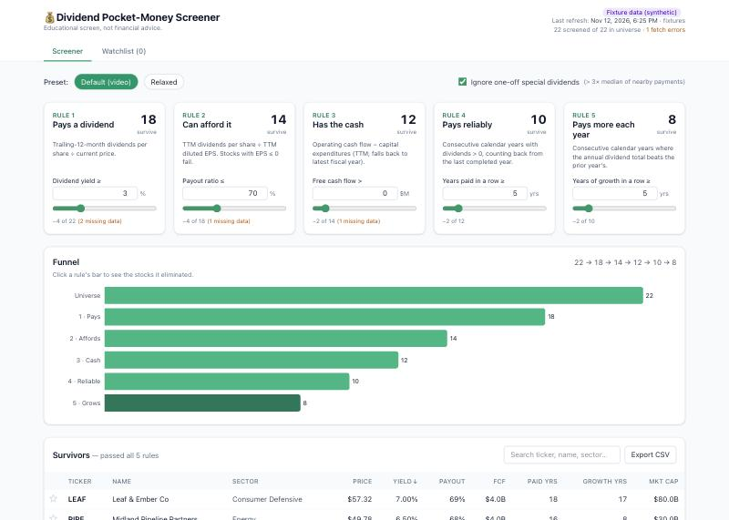

# 💰 Dividend "Pocket Money" Screener

A local web app that screens the US stock universe with 5 sequential dividend rules, shows how many stocks survive each rule as a funnel, and lists the survivors for tracking.

> [!IMPORTANT]
> **This is a personal and educational project, not financial advice.** It is not a recommendation to buy, sell or hold any security. The data comes from an unofficial source and may be delayed, incomplete or wrong. Do your own research and consult a licensed professional before investing.

**Live site:** https://shuhanstack.github.io/dividend-screener/ (refreshed weekly)



| # | Rule | Metric | Default |
|---|------|--------|---------|
| 1 | Pays a dividend | TTM dividends per share ÷ price | ≥ 3% |
| 2 | Can afford it | TTM dividends ÷ TTM diluted EPS (EPS ≤ 0 fails) | ≤ 70% |
| 3 | Has the cash | Operating cash flow − capex (TTM, else latest FY) | > $0 |
| 4 | Pays reliably | Consecutive calendar years with dividends > 0 | ≥ 5 yrs |
| 5 | Pays more each year | Consecutive years where the annual total beats the prior year | ≥ 5 yrs |

Rules are applied in order, and each one only sees the stocks that survived the previous rule. A stock with a missing metric fails that rule, and the funnel counts it separately as "missing data".

## Quick start

Requirements: Python 3.11+, Node 20+.

```bash
make install          # backend/.venv + frontend/node_modules
make dev-fixtures     # offline demo with 22 synthetic tickers → http://localhost:5173
```

With real data:

```bash
make refresh-dev      # ~50 well-known tickers, ~15 s
make dev              # API on :8000 + Vite on :5173
make refresh          # full US universe (see timings below)
```

Without `make`:

```bash
cd backend && .venv/bin/uvicorn app.main:app --port 8000      # add DIVSCREEN_FIXTURES=1 for offline mode
cd frontend && npm run dev
```

`make build && make serve` serves the built frontend from FastAPI on a single port (:8000).

Tests: `make test` (pytest + strict TypeScript check).

## Refresh job

```
python -m app.refresh [--limit N] [--tickers KO,PG,...] [--workers 6] [--force]
                      [--full] [--retry-errors] [--compute-only] [--fixtures]
```

- **Universe.** The job downloads `nasdaqlisted.txt` and `otherlisted.txt` from nasdaqtrader.com, then drops ETFs, test issues, warrants, units, rights, preferreds and notes. About 5,900 remain: common stocks plus closed-end funds, which have no ETF flag and are kept on purpose. The commonly quoted ~8,000 figure includes ETFs.
- **Cache.** Normalized responses are cached in SQLite (`raw_data`, with `fetched_at`). Tickers refreshed within the last 24h are skipped unless you pass `--force`. A failed fetch is logged to `backend/data/refresh.log` and skipped, and any older good payload is kept.
- **Speed shortcut.** Non-payers (no dividend in the last ~13 months) get only the price-history call and skip fundamentals, because they fail rule 1 either way. Pass `--full` to fetch everything for every stock.
- **Compute.** After fetching, all metrics are recomputed into the `metrics` table. Screening is an in-memory pass over that table, with no network calls at request time.
- **Timing.** A full run on a home connection took **≈ 12 minutes** (≈ 8 tickers/s with 6 workers). Yahoo throttles unpredictably. If you see many `RateLimit` errors, lower `--workers` and rerun with `--retry-errors`.

## Weekly automation (GitHub Actions → GitHub Pages)

[`.github/workflows/refresh-and-deploy.yml`](.github/workflows/refresh-and-deploy.yml) runs **once a week**, on Saturdays at 10:00 UTC (after Friday's US close). You can also start it from the Actions tab with **Run workflow**.

Each run does the following:

1. **Restores last week's database** from the repo's `data` branch, using [`scripts/data-branch.sh`](scripts/data-branch.sh). The branch holds one commit, the gzipped SQLite database (~3 MB), and is force-pushed each run so the repo doesn't grow.
2. **Refreshes from Yahoo** with a **200-minute time budget**, then makes one 30-minute retry pass for failed tickers. Stocks are fetched oldest-data-first, so a run that stops early is picked up where it left off next week.
3. **Saves the database back** to the `data` branch. This step always runs, even if the refresh step failed, but is skipped if the database fails an integrity check.
4. **Checks before publishing.** Fewer than 3,000 stocks with data means no publish. More than half of stocks not refreshed adds a warning.
5. **Exports and deploys.** It writes `screen.json` and `details.json` and builds the frontend with `VITE_STATIC=1`, which does the screening **in the browser** with the same rules as the API (verified identical on 432 threshold combinations). The result is deployed to GitHub Pages.

On the static site the watchlist is stored in your browser's localStorage, since there is no server.

### What happens when Yahoo is slow or fails

| Situation | Result |
|---|---|
| One stock fails to download | It keeps last week's data, marked ⏱ "not refreshed in the latest run" |
| A download succeeds but is missing fields (e.g. EPS or cash flow) | Those fields keep their last known values, marked ⏱ with the field names and their original date |
| Yahoo is slow and the time budget runs out | The site publishes fresh data where it arrived and last week's data for the rest. Next week starts with the oldest data |
| The run fails, or fewer than 3,000 stocks have data | Nothing is published. GitHub Pages keeps serving the previous site |
| nasdaqtrader.com is down | The refresh reuses last week's stock list |

The header shows how many stocks are showing older data. Hover over ⏱ on a row, or open the stock, to see why and from when.

Setup, done once:

- The repo is public, because Pages on GitHub's free plan needs a public repo.
- Under **Settings → Pages**, the source is set to **GitHub Actions**.

Caveats:

- Yahoo sometimes throttles GitHub's cloud servers. The **first run** starts with no previous data, so if it is cut short it may not reach the 3,000-stock threshold and won't publish. Run it again from the Actions tab; it continues from where it stopped.
- GitHub disables scheduled workflows in public repos after 60 days without repository activity. Re-enable it from the Actions tab, or push any commit.

To try the static build locally:

```bash
cd backend && .venv/bin/python -m app.export --out ../frontend/public/data   # or --fixtures
cd frontend && VITE_STATIC=1 npm run dev
```

## Metric details

- **Split-adjusted dividends.** yfinance history is already split-adjusted. Providers that return raw amounts set `dividends_adjusted: false`, and `metrics.split_adjust` handles them.
- **Streaks.** Streaks count back from the **last completed calendar year**, so a partial current year never breaks them.
- **Special dividends** (the toggle, on by default). A payment counts as special when it is more than 3× the median of the stock's other payments within ±2 years, on *both* sides where data exists. A local median is used because decades of dividend growth would otherwise make every recent payment look "special". The two-sided check stops a switch from quarterly to annual payments being flagged.
- **Ex-date timing.** When an ex-date slides across Jan 1, one year gets 5 quarterly payments and the next looks like a cut. For years with extra payments, or fewer payments offset by a neighbouring year with extras, the growth comparison uses *median payment × usual frequency*. A genuine mid-year suspension is not normalized, so it still counts as a cut.
- **Raw streak lengths** for rules 4 and 5 are stored for both variants (`*_all` and `*_reg`), so the toggle is a free switch at query time.

## API

| Endpoint | Description |
|---|---|
| `GET /api/screen?yield_min=3&payout_max=70&fcf_min=0&paid_years_min=5&growth_years_min=5&ignore_specials=true` | `{funnel: [{step, label, remaining, failed, failed_missing_data}], results: [...]}` |
| `GET /api/screen/eliminated?step=N&…` | Stocks eliminated at step N (largest first) |
| `GET /api/stock/{ticker}?…` | Metrics, per-rule checks, annual dividends, specials, EPS/FCF history |
| `GET /api/stock/{ticker}/prices` | Weekly closes, last 3 years (cached at refresh; older caches backfill from Yahoo on first view) |
| `GET /api/meta` | Last refresh, universe size, fetch errors |
| `GET/POST/DELETE /api/watchlist[/{ticker}]` | Watchlist; GET flags rules each stock now fails |

## Fixtures / offline mode

`backend/tests/fixtures/tickers/*.json` holds **22 synthetic companies** with fictional tickers. Each one exercises a rule or an edge case: a split stored unadjusted, a special dividend, a partial year, a missing year, a cut, negative EPS, missing EPS/price/cash flow, a fiscal-year FCF fallback, a REIT with payout over 100%, and a simulated fetch failure. Regenerate them with `make fixtures`. Fixture mode (`DIVSCREEN_FIXTURES=1`) rebuilds `backend/data/fixtures.db` at startup and uses a fixed as-of date of 2026-11-01.

## Plugging in a paid provider

Providers implement `DataProvider.fetch(ticker, full) -> TickerData` (`backend/app/providers/base.py`). A Financial Modeling Prep implementation is included:

```bash
cp .env.example .env   # set DIVSCREEN_PROVIDER=fmp and FMP_API_KEY=...
make refresh
```

The FMP provider targets FMP's `/stable` endpoints but **has not been run against a live key**, so field names may need small adjustments for your plan. To add another source, write a class that returns the same `TickerData` dict and register it in `providers/__init__.py`.

## Data-source caveats

- **yfinance is unofficial.** It scrapes Yahoo Finance, which may rate-limit, change format, or return stale or incomplete data. Treat the numbers as indicative.
- **Yahoo's dividend history** sometimes holds stray off-schedule entries and only goes back to ~1962. Long streaks therefore come out shorter than the published "Dividend King" counts (e.g. PG shows 42 growth years vs. 69 published, KO 55 vs. 63). This rarely matters at a 5-year threshold.
- **Payout uses GAAP diluted EPS.** REITs (e.g. O) and MLPs usually fail rule 2 because they are judged on FFO/DCF rather than EPS. Large one-off charges can also spike the payout (e.g. GPC).
- **FCF for banks and insurers** (e.g. JPM) swings with balance-sheet flows and is often negative or meaningless.
- **Foreign ADRs** may report dividends in USD after withholding or currency conversion, so yields can be noisy.
- Fetch failures are mostly delisted or renamed symbols that remain in the nasdaqtrader files.
